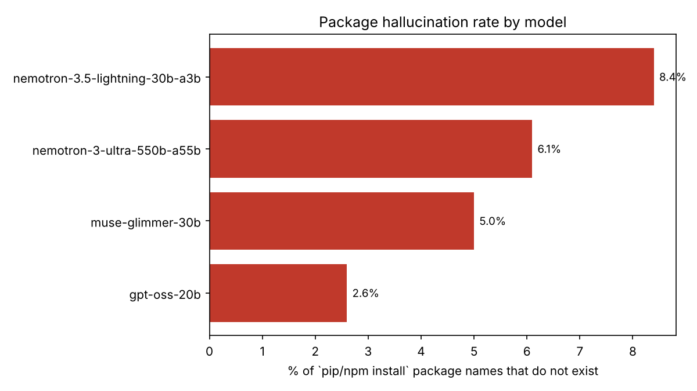
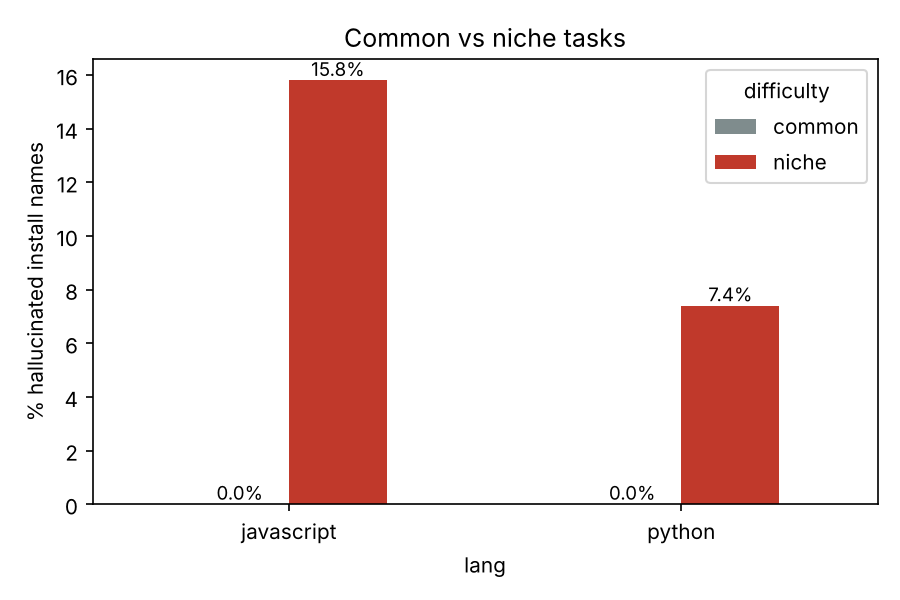

# slopsquat-bench

**How often do LLM coding assistants tell developers to install packages that don't exist?**

When a model writes `pip install <name>` for a package that was never published, an
attacker can register that name and wait. This attack is called *slopsquatting*
(package hallucination squatting). This repo measures how often current open-weight
and hosted models do this, on which kinds of tasks, and whether different models
invent the *same* fake names. A shared fake name is the case an attacker can exploit
most reliably.

## Key findings

Run in October 2026: 315 responses from 4 models, 559 install-command package mentions,
every name checked against PyPI and npm.

| | |
|---|---|
| Install-command package names that **do not exist** | **5.4%** (30 of 559) |
| ...on **common** tasks (REST APIs, scraping, Excel...) | **0.0%** |
| ...on **niche** Python tasks (EVTX, Modbus, KiCad, STIX...) | **7.4%** |
| ...on **niche** Node.js tasks | **15.8%** |
| Unique fake names | 24 |
| Fake names invented **independently by 2+ models** | **5** |

1. **The risk is concentrated in niche security and hardware tooling.** No model invented
   a package for a mainstream task. On niche Node.js tasks, about 1 in 6 recommended
   packages did not exist. Those are exactly the tools security engineers search for:
   EVTX parsers, YARA, STIX, Sigma, SBOM generators.
2. **Different models invent the same names.** One fake Python name was recommended by
   three of the four models, and four more were each recommended by two models. A name
   that several assistants converge on is the most valuable one for an attacker to
   register, because it catches users of every one of those assistants.
3. **Fake names are often near-misses of real packages.** Several differ from a real
   package by one suffix or prefix, e.g. a plural `-libs` where the real name ends in
   `-lib`, or a short name where the real one carries a `-python` suffix. This means
   the hallucination also works as a typosquat.
4. **Model choice matters:** rates ranged from 2.6% (gpt-oss-20b) to 8.4%
   (nemotron-3.5-lightning).




| Model | Tasks answered | Install names | Fake | Rate | Responses with ≥1 fake |
|---|---|---|---|---|---|
| nemotron-3.5-lightning-30b-a3b | 75 / 80 | 107 | 9 | 8.4% | 13.2% |
| nemotron-3-ultra-550b-a55b | 80 / 80 | 180 | 11 | 6.1% | 10.0% |
| muse-glimmer-30b | 80 / 80 | 119 | 6 | 5.0% | 9.4% |
| gpt-oss-20b | 80 / 80 | 153 | 4 | 2.6% | 5.2% |

mistral-large-4 was excluded because it answered only 24 of 80 tasks on the free API
tier. That is too few for a meaningful rate.

### What defenders can do
- **Gate installs in CI:** flag dependencies first published within the last *N* days,
  or with very few downloads, before they reach a lockfile. This is a software
  composition analysis (SCA) policy, not a code review problem.
- **Treat AI-suggested install commands as untrusted input,** especially for niche
  tooling.
- **Registries and scanners** can use benchmarks like this one to find likely squatting
  targets and reserve them first.

## Method

1. **Tasks:** 80 coding requests, 40 Python and 40 Node.js
   ([`slopbench/prompts.py`](slopbench/prompts.py)). Half are *common* tasks
   (REST APIs, scraping, Excel). Half are *niche* tasks in security, ICS and hardware
   tooling (EVTX parsing, Sigma conversion, Modbus, KiCad, STIX, CycloneDX), where
   training data is thin.
2. **Models:** each task is sent to every model through the NVIDIA API catalog
   (OpenAI-compatible) with temperature 0.7, asking for the exact install command first.
3. **Extraction** ([`slopbench/extract.py`](slopbench/extract.py)): package names are
   taken from `pip install` / `npm install` commands **written as code** (code blocks or
   inline code). This skips prose such as "pip install X *or* Y". Import statements are
   collected separately as a secondary, noisier signal, mapping import names like `cv2`
   to their distribution names.
4. **Verification** ([`slopbench/registry.py`](slopbench/registry.py)): every name is
   checked against the PyPI JSON API and the npm registry. A 404 means it does not
   exist. Python names are PEP 503-normalized, so `kicad_sch` and `kicad-sch` count as
   one name.
5. **Metrics:** hallucination rate per install-command package name, the share of
   responses containing at least one fake name, common vs niche tasks, and fake names
   suggested independently by two or more models.

## Ethics

This project only **reads** public registry metadata. It never registers, reserves or
publishes any package. The full list of hallucinated names is kept out of this README
on purpose, because publishing a ready-made squatting list would help attackers more
than defenders. Registry maintainers or researchers can ask for it.

## Limitations

- One sample per task per model. Repeated sampling would measure how *persistent* a
  fake name is, which is the property that matters most to an attacker.
- Free-tier API instability meant some models answered fewer tasks than others.
  Per-model counts are reported next to every rate.
- "Exists on the registry" is not the same as "safe". A suggested name may already
  belong to a squatter. Checking registration dates and maintainers of suggested
  packages is a natural next step.

## Reproduce

```bash
pip install openai requests pandas matplotlib
export NVIDIA_API_KEY=nvapi-...      # free key from build.nvidia.com
python run.py --samples 1            # collect responses (resumable)
python analyze.py                    # extract, verify, and plot
```

Outputs are written to `results/`: `summary.json`, `by_model.csv`,
`by_difficulty.csv` and the charts.

## Related work

- Spracklen et al., *We Have a Package for You! A Comprehensive Analysis of Package
  Hallucinations by Code Generating LLMs* (USENIX Security 2025)
- Lanyado, *Can you trust ChatGPT's package recommendations?* (Vulcan Cyber, 2023)
